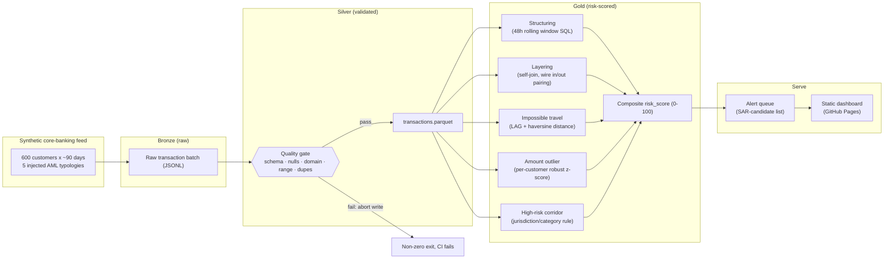

# AML Transaction Monitoring Pipeline

[](https://github.com/vabhishek8/aml-transaction-monitoring-pipeline/actions/workflows/pipeline.yml)

A rule-based transaction-monitoring pipeline that looks for five real AML typologies in a synthetic retail-banking feed: structuring, layering, impossible travel, statistical amount outliers and high-risk-corridor routing. The detection is SQL, and the tests check it catches every case I planted, not just that it runs.

**[Live dashboard →](https://vabhishek8.github.io/aml-transaction-monitoring-pipeline/)**

It's the second of three pipelines, after [azure-medallion-weather-pipeline](https://github.com/vabhishek8/azure-medallion-weather-pipeline), and it's aimed squarely at banking. The detection logic is framed around what AML compliance actually requires, and the Azure IaC is written for what a bank's security review checks, rather than for the lowest cost.

## Why I built it

"I trained a fraud model on the Kaggle credit card dataset" shows you can call `.fit()`. It doesn't show judgment about banking data. I wanted to work through the questions a transaction-monitoring engineer actually has:

- What counts as evidence that a detection rule works, when production data has no ground-truth labels?
- How do you check a rule catches the pattern it's meant to, without burying investigators in false positives?
- Where do record-keeping rules (immutability, lineage, retention) turn into architecture requirements?

There's no real transaction data in here, and there couldn't be, because it doesn't exist publicly. `src/generate_transactions.py` builds a realistic batch and deliberately plants the five typologies with a recorded ground truth. Then `src/gold.py` is validated the way a monitoring team validates a new rule before it sees production: plant known scenarios, then measure recall and the false-positive rate.

## How it's wired



Each detection signal is tested on its own against the planted ground truth in `tests/test_gold.py`. If you only read one file, read that one.

## How well it detects (measured)

Recall is measured per case: did the scheme raise an alert on any of its transactions? A real monitoring system alerts once a pattern has enough evidence, not on every leg of it after the fact, so row-level recall would be measuring the wrong thing.

| Typology | Case-level recall | Notes |
|---|---|---|
| Structuring | 100% | Flags once cumulative sub-CTR-threshold deposits cross ~90% of AUD 10,000 within a rolling 48h window |
| Layering | 100% | Self-join pairs a wire-in with a same-customer wire-out of similar magnitude within 6h |
| Impossible travel | 100% | Haversine distance / elapsed time vs. the customer's immediately prior transaction, thresholded above commercial flight speed |
| Amount outlier | 100% | Per-customer **median/MAD** z-score (see below; this replaced a naive mean/stddev version) |
| High-risk corridor | 100% | Deterministic jurisdiction/merchant-category rule |

On clean, unplanted transactions the false-positive rate is 7.9% overall. 86% of those are `high_risk_corridor` firing correctly on genuinely high-risk-jurisdiction transactions that just weren't part of a planted scenario, so they're not errors. `impossible_travel` adds a real, explainable false-positive rate of about 1.5%, because the synthetic timestamps are uniformly random and sometimes cluster by chance. In production I'd tighten that rule with the customer's actual travel history and card-present signals, not tune it against a synthetic artifact.

## What broke, and how it got caught

My first `amount_outlier` rule scored each transaction against the customer's own mean and standard deviation. Recall was 20%. The outlier inflates the very standard deviation it's being measured against, and the effect is worst for customers with only a few transactions, where the small-sample correction makes it bigger. Switching to median and MAD (median absolute deviation), which barely move for one extreme value, took recall from 20% to 100%, with the false-positive rate for that rule on clean data at 0.01%.

There's a test meant to pin this down for low-volume customers, `test_amount_outlier_uses_robust_stat_not_skewed_by_own_outlier`. Right now it skips: with the fixed seed, no low-volume customer gets a planted outlier, so it has nothing to check. The fix is still covered by the case-level recall test, which passes for `amount_outlier`, but the targeted guard needs its own fixture before it protects anything.

## The Azure version, and why it isn't running

`infra/main.bicep` maps the same bronze, silver and gold design to a governed Azure estate. The calls are different from a generic template because the data is different:

| Decision | Reasoning |
|---|---|
| No public network access anywhere (storage, Key Vault, ADF, Synapse) | Every data-bearing service sits behind a private endpoint in a dedicated VNet. This is the default posture a bank's InfoSec review expects, not an opt-in hardening step. |
| Account-level immutable storage with versioning | Transaction records and the alerts derived from them need a defensible chain of custody. AML/CTF Act and SAR record-keeping obligations are a data-architecture requirement, not just a policy document. |
| Microsoft Purview | Centralised lineage/classification across bronze → silver → gold. BCBS 239's risk-data-aggregation principles are fundamentally about provable data lineage and ownership, not modelling accuracy. |
| RBAC-authorized Key Vault, purge protection on, 90-day soft-delete | No legacy access policies; every identity is granted the minimum role (`Key Vault Secrets User`, `Storage Blob Data Contributor`) scoped to a single resource. |
| Synapse **managed virtual network** | Compute-to-storage traffic never traverses the public internet, even for intra-service calls. |
| 365-day Log Analytics retention in prod (vs. 60-day ops-only baseline) | This is an audit trail, not just operational telemetry. |
| Not deployed and left running | A standing environment holding transaction-shaped data (even synthetic) with no active monitoring owner is itself a finding in most banking security reviews, same cost-discipline argument as the companion weather-pipeline project, with a compliance angle added. |

Validated with `bicep build` (0 errors, 25 resources). To deploy it on demand:

```bash
az deployment group create \
  --resource-group rg-aml-pipeline-dev \
  --template-file infra/main.bicep \
  --parameters environment=dev alertEmail=you@example.com
```

## Running it locally

```bash
python -m venv .venv && source .venv/bin/activate
pip install -r requirements.txt
python src/pipeline.py           # generate -> silver -> gold -> dashboard
PYTHONPATH=src pytest tests/ -v  # 29 tests (28 pass, 1 skips; see below)
open docs/index.html
```

## Repo layout

```
src/
  generate_transactions.py   synthetic core-banking feed, 5 injected AML typologies with recorded ground truth
  quality_checks.py           the silver quality gate
  transform.py                 bronze -> silver: parse, validate, dedupe
  gold.py                       risk-scoring SQL: structuring, layering, impossible travel, outlier, corridor
  dashboard.py                   renders gold -> static Plotly HTML (risk distribution, alert queue)
  pipeline.py                     orchestrates all four stages
tests/                          29 pytest cases, including case-level recall and false-positive assertions
infra/main.bicep                production Azure IaC: private-endpoint-only, immutable storage, Purview, RBAC
.github/workflows/               scheduled CI: test -> run -> commit refreshed gold data
```

## Stack

Python, pandas, DuckDB (window functions, self-joins, haversine SQL), Plotly, pytest and GitHub Actions. The Bicep covers a VNet with private endpoints, ADLS Gen2 immutable storage, Key Vault RBAC, Azure Data Factory, a Synapse managed VNet, Microsoft Purview and Log Analytics.

---

Built by [Abhishek Vadlamudi](https://abhishekvadlamudi.com), Senior Business Intelligence Engineer at Unisys in Sydney.
